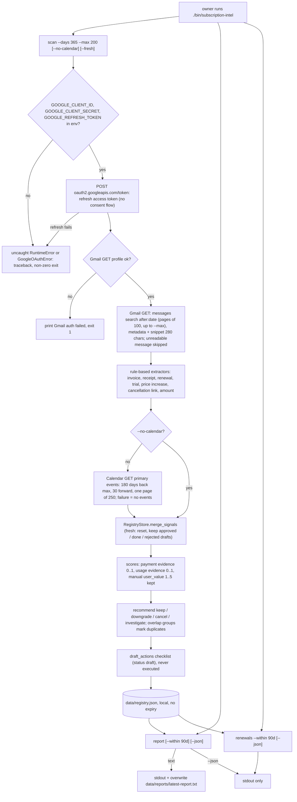
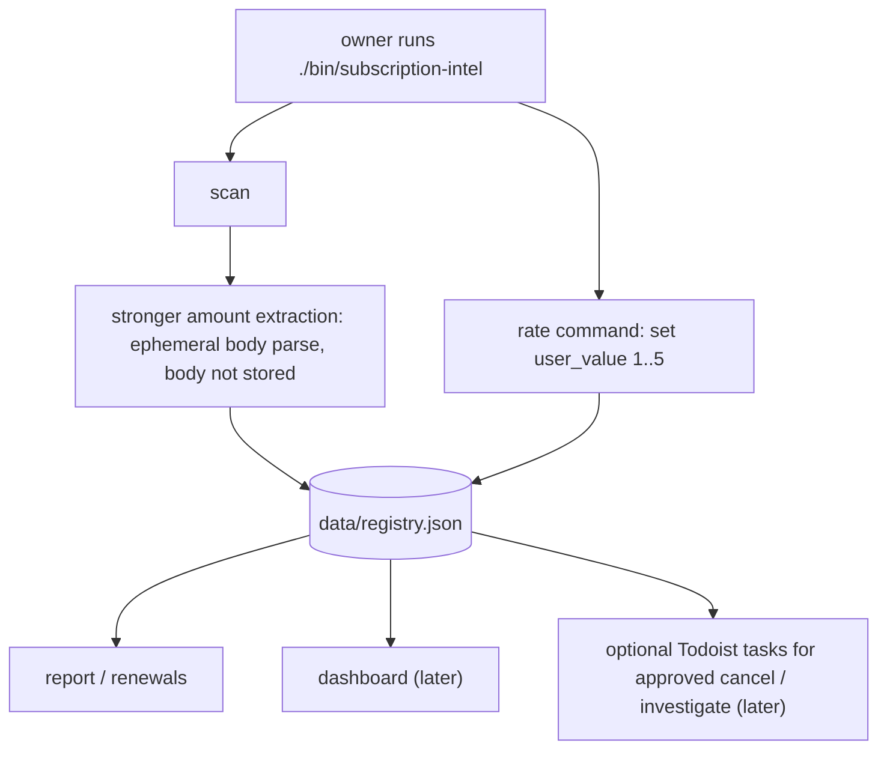

# 01 — Business process (As-Is / To-Be)

Subscription Intelligence (`finance-subscription-cli`) คือ CLI ที่ owner รันในเครื่องเอง อ่าน Gmail และ Google Calendar แบบอ่านอย่างเดียว เพื่อหาว่าจ่ายค่า subscription อะไรอยู่ ต่ออายุเมื่อไร และยังคุ้มไหม แล้วเก็บผลใน `data/registry.json` ในเครื่อง ไม่มี service ที่ host และไม่ยกเลิกอะไรเอง

Last reviewed: 2026-11-27 · commit `304dc79`

## As-Is (จากโค้ดวันนี้)

Sources: `src/subscription_intelligence/cli/__main__.py` (`cmd_scan`, `cmd_report`, `cmd_renewals`, `_parse_within`), `src/subscription_intelligence/infra_bridge.py`, `src/subscription_intelligence/http_util.py`, `src/subscription_intelligence/gmail_adapter/client.py`, `src/subscription_intelligence/calendar_adapter.py`, `src/subscription_intelligence/extractors/signals.py`, `src/subscription_intelligence/subscription_registry/store.py`, `src/subscription_intelligence/scoring/worth.py`, `src/subscription_intelligence/recommendations/engine.py`, `src/subscription_intelligence/paths.py`, `README.md`, `PRODUCT.md`

ข้อเท็จจริงจากโค้ด:

- Gmail และ Calendar ใช้ GET เท่านั้น; ไม่มี label, archive, delete, send หรือการเปิด cancellation URL
- adapter สร้าง token ก่อนบล็อก `try` ใน `cmd_scan` จึงมีแค่ความล้มเหลวของ `profile()` ที่ได้ข้อความ "Gmail auth failed"; env ขาดหรือ refresh ล้มเหลวจะจบด้วย traceback
- `report` / `renewals` ตอบ exit 1 เมื่อ registry ว่าง ("Run: subscription-intel scan")
- ไม่มีคำสั่งตั้ง `user_value`: ค่าจะมีได้ก็ต่อเมื่อแก้ `data/registry.json` เอง และ merge ถัดไปเก็บค่านั้นไว้ **[ต้องยืนยัน]** ว่า owner ใช้วิธีนี้จริง
- README ระบุ action `consider_subscribe` แต่ `_recommend()` ไม่เคยคืนค่านี้
- ไม่มี scheduler หรือ cron: รันด้วยมือเท่านั้น; CI (push `main`, PR) รัน shared `ci-python` บน Python 3.10 และ 3.13 และ security scan
- ไม่ได้ตรวจว่า OAuth grant ที่ใส่จริงมีแค่ scope อ่านอย่างเดียว (README §Permissions) **[ต้องยืนยัน]**

## To-Be (README.md §Roadmap)

Sources: `README.md` §Roadmap (Now / Next / Later); `PRODUCT.md` §AI / LLM, §Limits

## Gap

| ID | As-Is → To-Be | Status | Owner | Evidence |
|---|---|---|---|---|
| G1 | ดึงจำนวนเงินจาก metadata + snippet เท่านั้น → parse body แบบชั่วคราว (ไม่เก็บ body) | todo | claude | `README.md` §Roadmap 2 (Next); `PRODUCT.md` §Limits |
| G2 | ไม่มีคำสั่งตั้ง `user_value` → คำสั่ง `rate` | todo | claude | `README.md` §Roadmap 2 (Next) |
| G3 | มีแค่ CLI text / JSON → dashboard | todo | owner | `README.md` §Roadmap 3 (Later) |
| G4 | draft action อยู่ใน registry เท่านั้น → สร้าง Todoist task (optional) สำหรับ cancel / investigate ที่ approved | todo | owner | `README.md` §Roadmap 4 (Later) |
| G5 | ไม่มีชุด eval วัดความแม่นของ extraction → มีชุด eval | todo | claude | `PRODUCT.md` §AI / LLM ("gap") |
| G6 | README ระบุ `consider_subscribe` แต่ engine ไม่สร้าง → owner ตัดสินว่าจะเพิ่มกฎหรือลบออกจาก README | decide | owner | `README.md` §What it does 5; `recommendations/engine.py` `_recommend` |
| G7 | ข้อมูลในเครื่องไม่มี retention หรือ expiry อัตโนมัติ และไม่มีเป้าหมายที่เขียนไว้ → owner กำหนดนโยบาย retention | decide | owner | `README.md` §Retention |

## Open questions

- Calendar อ่านหน้าเดียว 250 events ไม่ paginate (`PRODUCT.md` §Limits): ต้องแก้หรือยอมรับเป็นข้อจำกัดถาวร
- grant ที่ใช้จริงจำกัด scope `gmail.readonly` และ `calendar.events.readonly` แล้วหรือยัง
